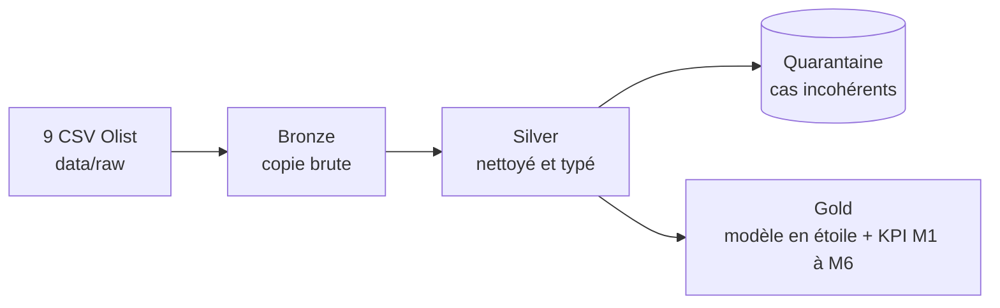

# Lakehouse E-commerce

Pipeline Big Data en **PySpark** et architecture **Médaillon** (Bronze, Silver, Gold) sur le jeu de données public **Olist** (e-commerce brésilien : 9 fichiers CSV, environ 100 000 commandes, 2016 à 2018). Le projet va de l'audit des données brutes jusqu'à un modèle en étoile et six familles d'indicateurs métier, avec réconciliation du chiffre d'affaires entre les couches et une étude d'optimisation Spark mesurée.

Auteur : `<ton nom>`, étudiant en Big Data, EMSI (Maroc).

## Architecture



| Couche | Rôle |
|---|---|
| Bronze | Copie fidèle des sources, après audit (clés, doublons, valeurs manquantes). |
| Silver | Types corrigés, règles de qualité appliquées, lignes incohérentes écartées vers une quarantaine. |
| Gold | Modèle dimensionnel (Kimball) en constellation et tables d'indicateurs prêtes à l'analyse. |

## Résultats clés

**Réconciliation du chiffre d'affaires** (Bronze, Silver, Gold) :

| Étape | CA (R$) |
|---|---|
| Bronze | 13 591 643,70 |
| moins la quarantaine | 3 098,61 |
| **Silver** | 13 588 545,09 |
| moins les commandes annulées ou indisponibles | 97 242,96 |
| **Ventes (Gold)** | **13 491 302,13** |

Le même total se retrouve dans les trois requêtes d'optimisation (Pareto, sessions/RFM, jointures).

**Modèle Gold** : 23 tables, dont 6 de base (`fact_order_items`, `fact_orders`, `dim_date`, `dim_product`, `dim_seller`, `dim_customer`) et 17 tables d'indicateurs (`kpi_m1_*` à `kpi_m6_*`).

**Indicateurs** (détails, limites et causes non établies dans le [rapport final](docs/rapport_final.md)) :

- **M1** : ventes par catégorie (Pareto) et série mensuelle. 18 catégories sur 74 réalisent 80 % du CA.
- **M2** : géographie (états et régions). Le taux de commandes livrées en retard est de 12,76 % dans le Nordeste, contre environ 6 % ailleurs.
- **M3** : livraison et satisfaction. Note moyenne de 2,27 pour les commandes en retard contre 4,29 sinon (constat ; la cause n'est pas établie).
- **M4** : segmentation RFM et rachat. Taux de rachat de 1,28 % à 90 jours sur une cohorte à horizon fixe.
- **M5** : statuts de commandes et anomalies (1 713 commandes bloquées plus de 60 jours dans un statut non final).
- **M6** : paiements (types, combinaisons, échéances, écarts).

**Optimisation Spark** (mesurée sur environ 10 Mo, voir [l'étude](docs/Optimisation.md)) :

- Désactiver l'AQE en gardant 200 partitions : environ 3 fois plus lent sur la requête de sessions.
- Forcer un sort-merge à la place du broadcast : environ 28 % plus lent sur la requête à deux jointures.
- Mettre en cache seulement les colonnes utiles : environ 34 % plus rapide que sans cache ; le cache des 14 colonnes est plus lent.
- `reduceByKey` écrit environ 160 fois moins de shuffle que `groupByKey`.

## Stack

PySpark 3.5.0, Parquet, JupyterLab, Docker et Docker Compose.

## Lancer le projet

1. Télécharger les 9 CSV du jeu de données Olist (Kaggle) et les placer dans `data/raw/`. Les données ne sont pas versionnées.
2. Démarrer l'environnement :

```bash
docker compose up --build
```

3. Ouvrir JupyterLab sur http://localhost:8889 (si un jeton est demandé, il est affiché dans `docker compose logs spark`). La Spark UI est sur http://localhost:4040 pendant l'exécution d'un notebook.
4. Exécuter les notebooks dans l'ordre. Les données sont écrites dans `data/bronze/`, `data/silver/` puis `data/gold/`.

| Notebook | Contenu |
|---|---|
| `00_exploration.ipynb` | Exploration des 9 fichiers sources |
| `01_bronze.ipynb` | Couche Bronze |
| `02_silver.ipynb` | Nettoyage, règles de qualité, quarantaine |
| `03_gold.ipynb` | Modèle en étoile, indicateurs M1 à M6, réconciliation du CA |
| `04_optimisation.ipynb` | Plans d'exécution, mesures, comparaisons Spark |

## Structure du dépôt

```
.
├── Dockerfile
├── docker-compose.yml
├── docs/            documentation (cadrage, audit, schéma, Silver, Gold, optimisation, rapport final)
├── notebooks/       les cinq notebooks du pipeline
└── data/            non versionné (raw, bronze, silver, gold)
```

## Documentation

| Document | Contenu |
|---|---|
| [docs/cadrage.md](docs/cadrage.md) | Objectifs, périmètre et questions métier |
| [docs/audit_bronze.md](docs/audit_bronze.md) | Audit des données brutes |
| [docs/schema.md](docs/schema.md) | Schéma des données |
| [docs/silver.md](docs/silver.md) | Règles de nettoyage et quarantaine |
| [docs/gold.md](docs/gold.md) | Modèle en étoile, indicateurs, réconciliation, partitionnement |
| [docs/Optimisation.md](docs/Optimisation.md) | Étude d'optimisation Spark |
| [docs/rapport_final.md](docs/rapport_final.md) | Synthèse du projet, limites et suite |

## Méthode et rigueur

- Les chiffres attendus sont fixés par un audit avant chaque étape, puis comparés aux chiffres calculés.
- Chaque résultat est classé en constat (mesuré) ou en hypothèse (non démontrée) ; aucune cause n'est affirmée sans preuve.
- Les optimisations ne sont mesurées que sur des requêtes dont la justesse est vérifiée, avec 15 exécutions entrelacées et une règle de décision sur les intervalles interquartiles.

## Suite prévue

Refactoring en modules Python avec tests, outillage Docker/Makefile, contrôles de qualité automatisés, Delta Lake, orchestration Airflow, intégration continue, test de montée en charge, tableau de bord. Ces étapes sont planifiées et ne sont pas incluses dans la version 1.0.

## Données

Jeu de données public Olist (Kaggle). Se référer à la licence indiquée sur la page du jeu de données.